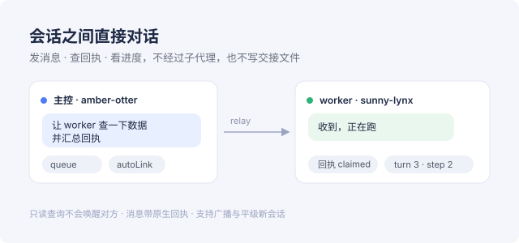

# dsh-session-relay

DeepSeek Harness（0.2.x）的**跨会话通信中继**：让同一进程里不同的会话（不是父子关系的子代理）互相发现、发消息、查回执、看进度、开平级新会话。



解决的痛点：worker 会话想通知「主控」、主控想盯多个 worker 的进度时，Harness 只提供「父会话 → 子代理」这一条路，于是只能写 `ALERT-*.md` 交接文件等对方巡检。本插件给每个会话一个稳定的 handle，让平级会话直接对话——消息走 Harness 原生通道，不新建进程，也不往仓库里写临时文件。

## 安装

```bash
dsh plugin --profile desktop add dsh-session-relay@0.1.1
```

**或者用 zip**：下载 [Release](https://github.com/Funniki/dsh-session-relay/releases) 里的 `dsh-session-relay-0.1.1.zip`，解压到固定目录后：

```powershell
powershell -ExecutionPolicy Bypass -File .\install.ps1     # Windows
sh ./install.sh                                            # macOS / Linux
```

装完重启 DSH，或到插件页把 bundle 关掉再开一次。零运行时依赖，不需要 `pnpm install`。

## 能做什么

| 能力 | 工具 |
|---|---|
| 发现会话 | `relay_list` · `relay_whoami` |
| 发消息 / 回信 / 广播 | `relay_send` · `relay_reply` · `relay_broadcast` |
| 查送达回执 | `relay_receipt` |
| 看进度（不唤醒对方） | `relay_status` · `relay_read` |
| 建关系 / 改名 | `relay_link` · `relay_unlink` · `relay_rename` |
| 生命周期 | `relay_spawn` · `relay_archive` · `relay_attach` |
| 三阶段护栏 | `relay_rule`：`before` 拦截、`after` 打回、`input` 重申 |

## 文档

- 完整使用说明：[plugin/README.md](plugin/README.md)
- 变更日志：[CHANGELOG.md](CHANGELOG.md)
- 开发与发布约定：[AGENTS.md](AGENTS.md)

## 仓库结构

```
plugin/         npm 包 dsh-session-relay（宿主半边、浏览器半边、展示资源、安装脚本）
verification/   发布门槛：宿主冒烟、产物复查、安装路径、跨宿主 schema 兼容
tools/          构建审计与打包
```

## 兼容性

- DSH `>=0.2.1-rc.5 <0.3.0`（已在 0.2.1-rc.5 与 0.2.2-rc.1 上验证）
- Node `^22.19.0 || >=24.0.0`
- **零运行时依赖**

## License

MIT
