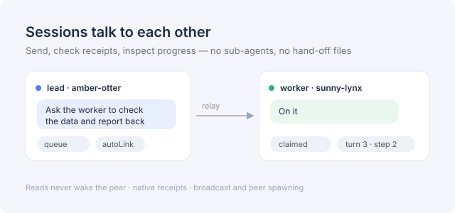

The pain it solves: when a worker session wants to tell the lead, or the lead wants to watch several workers, the harness only offers parent → subagent. Anything else means writing `ALERT-*.md` hand-off files and hoping someone polls.

This plugin gives every conversation a stable handle, so peers can find each other, send messages, check receipts, project progress and spawn new conversations — over the harness-native message path, without new processes or temporary files in your repository.
