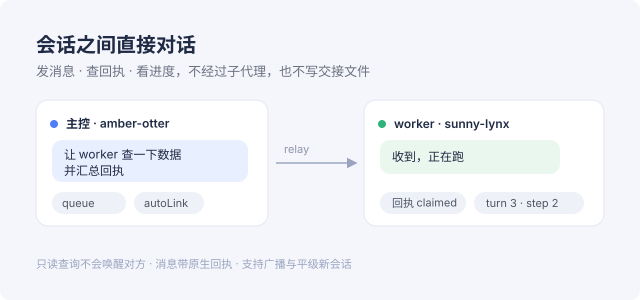

Harness 只提供「父会话 → 子代理」这一条路。多个平级会话要协作时，只能写 `ALERT-*.md` 之类
的交接文件，等对方巡检——慢、容易漏、还会污染工作区。

**本插件把会话连成一张网**：每个会话有稳定的 handle，可以互相发消息、查回执、看进度、开平级
新会话，全程走 Harness 原生的消息通道（`source.kind: agent-message` + `form: relay`），
不新建进程，也不往你的仓库里写临时文件。

## 能做什么

| 能力 | 工具 |
|---|---|
| 发现会话 | `relay_list`（handle / 标题 / 状态 / cwd，归档与子代理自动排除） |
| 发消息 / 回信 / 广播 | `relay_send` · `relay_reply` · `relay_broadcast` |
| 查送达 | `relay_receipt`：`pending` / `claimed` / `discarded` / `unknown` |
| 看进度不打扰 | `relay_status` / `relay_read`：只读，不唤醒对方 |
| 起平级会话 | `relay_spawn`（可指定 cwd，不是子代理） |
| 起昵称、建关系 | `relay_link` · `relay_unlink` · `relay_rename` |
| 三阶段护栏 | `relay_rule`：`before` 拦截工具调用、`after` 打回结果、`input` 重申约束 |

## 几个设计取舍

- **投递模式自己选**：`queue`（给对方开新回合，适合派活）、`steer`（插到当前回合的下一步边界，
  立即但不打断）、`inject`（只补上下文，不唤醒）。
- **回执是原生的**，不是自己造的状态机：消息落盘就是 Harness 的事件，回执由投递链路给出。
- **只寻址侧栏看得见的会话**：归档、空白占位、子代理一律拒绝；不能给自己发消息。
- **零运行时依赖**：宿主服务全走 `ctx.get`，安装时不拉任何第三方包。
